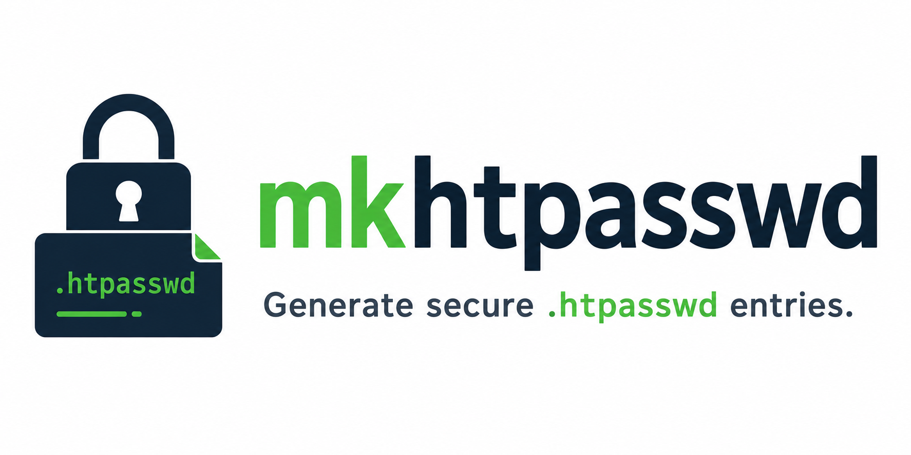

<p align="center">
  
</p>

# mkhtpasswd

Generate `.htpasswd` entries locally with a simple GUI or command line.

## Why

Users can generate encrypted passwords on their own machine without sending a
plain-text password to the administrator.

## Installation

### From source

```bash
go install mkhtpasswd/cmd/mkhtpasswd@latest
```

### Manual build

```bash
git clone <repo-url>
cd mkhtpasswd
go build ./cmd/mkhtpasswd
```

### Cross-compilation with fyne-cross

```bash
fyne-cross linux -output mkhtpasswd
fyne-cross darwin -output mkhtpasswd
fyne-cross windows -output mkhtpasswd
```

## Usage

### GUI mode

Run without arguments:

```bash
mkhtpasswd
```

### CLI mode

```bash
mkhtpasswd --user paulo --password "my password"
```

With a random password:

```bash
mkhtpasswd --user paulo --random --length 20 --symbols
```

Show the generated password (only with `--random`):

```bash
mkhtpasswd --user paulo --random --show-password
```

### Flags

| Flag | Description | Default |
|---|---|---|
| `--user` | Username | |
| `--password` | Password to encrypt | |
| `--random` | Generate a random password | false |
| `--length` | Password length | 20 |
| `--lower` | Use lowercase letters | true |
| `--upper` | Use uppercase letters | true |
| `--numbers` | Use numbers | true |
| `--symbols` | Use symbols | false |
| `--show-password` | Display generated password | false |
| `--cost` | bcrypt cost | 10 |
| `--password-stdin` | Read password from stdin | false |
| `--gui` | Force opening the GUI | false |
| `--version` | Show version | |

## Security

- Uses bcrypt (`$2y$`) for password hashing.
- Passwords are never written to disk.
- No Internet communication.
- No telemetry or data collection.
- No logs containing passwords.
- Generated passwords are hidden by default in CLI mode.
- The system clipboard is not cleared after copying; the `.htpasswd` entry may remain in the clipboard until overwritten.
- Passwords passed via `--password` are visible in the process list (`ps`, `/proc`). Use `--password-stdin` to avoid this.

## License

MIT